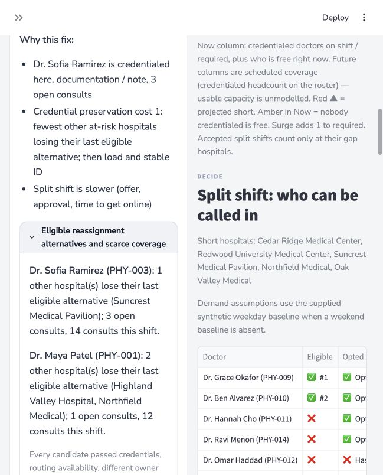

# Neuro Ops Command Center

**Rutgers Health Hack 2026 · Challenge 2 · Team 1 · Synthetic demonstration**

We turn an explained operational problem into an approved intervention while preserving scarce coverage.

The app reconstructs consult and physician state from events, ranks operational issues, projects scheduled coverage for two hours, and supports Clinical Lead approval and simulated physician responses. Reassignment preserves hospital credentials, remaining-shift requirements and scarce coverage alternatives. Handoffs retain original deadlines and expose acknowledgment status.

**Deployment:** publication to Streamlit Community Cloud is in progress. The verified public URL will be added here after deployment.



## Run locally

Use Python **3.11**, and run these commands from the repository root:

```sh
python3.11 -m venv .venv
source .venv/bin/activate
python -m pip install -r dashboard/requirements.txt
python -m streamlit run dashboard/app.py
```

Open the address printed by Streamlit. Choose **Reference 18:20 scenario**, keep **Live clock** off, and use **Clinical Lead** approval. The initial snapshot contains 18 open consults and eight on-shift physicians. Use +1/+5 minutes for explicit clock advancement.

## Demonstrate

1. Detect the urgent consult and explain its elapsed deadline and eligibility constraints.
2. Propose a split shift, approve as Clinical Lead, simulate acceptance, and inspect the coverage change.
3. Show restricted hospitals and the modeled seeded-workload routing comparison.
4. Upload `dashboard/demo/judge_test_events.csv` without restarting; inspect the new events and recommendations.
5. Reset the reference scenario and upload `dashboard/demo/credential_preservation_events.csv` for the controlled scarcity counterexample. The active rule selects PHY-003 over the less-loaded PHY-001 because it removes the last eligible alternative at one other at-risk hospital instead of two.
6. Inspect an actual reassignment's handoff packet and simulated acknowledgment states.

See the [four-minute script](docs/submission/demo_script.md) and [eight-demonstration checklist](docs/submission/acceptance_checklist.md).

## Verification

```sh
python dashboard/verify_hackathon.py --output /tmp/sevaro-verification
```

The runner executes 11 existing scripts, 9 focused regression scenarios and 30 Streamlit AppTest assertions. Test writes use isolated audit storage. Saved model examples are included so checks work from a standalone clone. [Evidence and limitations](docs/submission/README.md).

## Streamlit Community Cloud

- Repository: `Kundan265/RU_health-Sevaro-C2-T1`
- Branch: `main`
- Main file: `dashboard/app.py`
- Python: **3.11** in Advanced settings
- Dependencies: `dashboard/requirements.txt`
- Configuration: repository-root `.streamlit/config.toml`
- No API keys or secrets are required for the synthetic demonstration.

## Evidence boundaries

- All data and responses are synthetic or simulated. This is an independent hackathon prototype, not an official Sevaro product or a system for clinical use.
- Forecast cells represent **scheduled credentialed headcount**, not validated future usable capacity.
- Nine saved ML bundles load and reproduce supplied reference examples where expected outputs exist. Live estimates are suppressed where measurements or training-feature semantics are incomplete. Active decisions use explicit rules.
- Experimental pool sizing reports unavailable. The saved benchmark remains unchanged and includes a negative fixed-specialty-pool result.
- Workflow state is isolated per browser session and is not recovered after session loss or a restart. Cloud-local audit files are ephemeral; runtime logs are excluded from Git.
- Human task-time savings and clinical improvements have not been measured. The local 90/100 assessment is a disclosed reviewer rubric, not an official score.

See [scope and integration limits](dashboard/SCOPE_AND_LIMITS.md).

## Team history

This submission preserves the original Team 1 repository history and subsequent local improvements. The original team remote is retained locally. Challenge data and the saved benchmark are synthetic supplied/generated assets; model fixtures are copied without changing their predictions.
